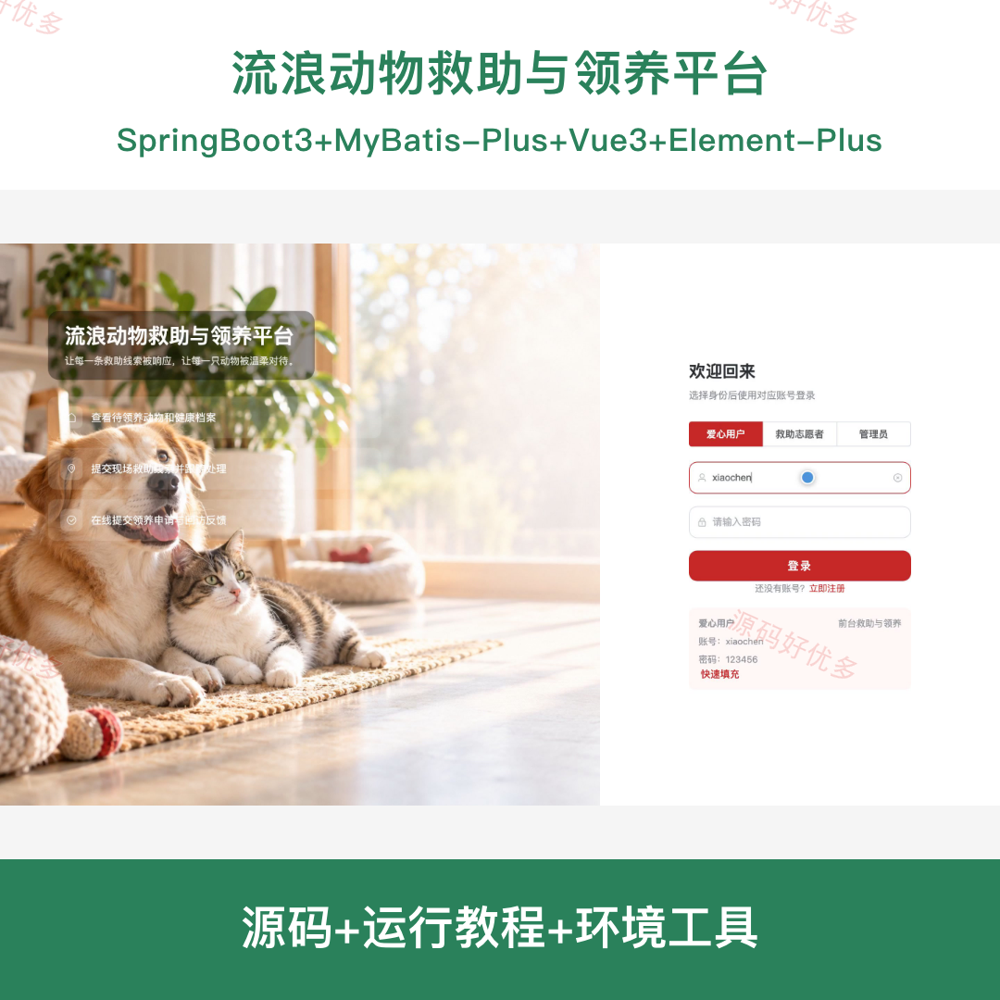
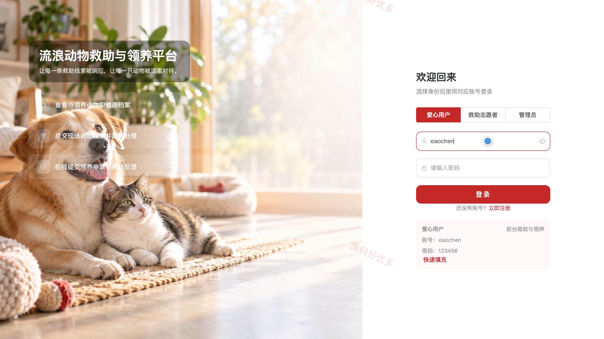
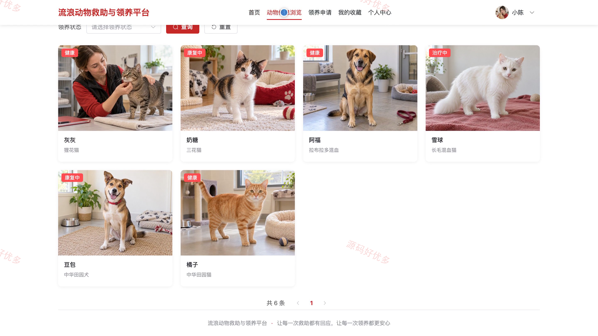
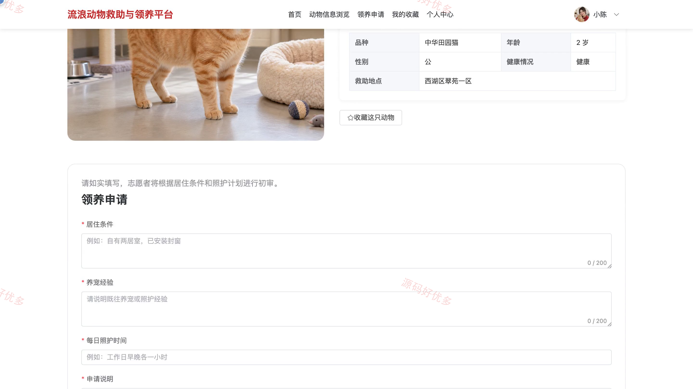
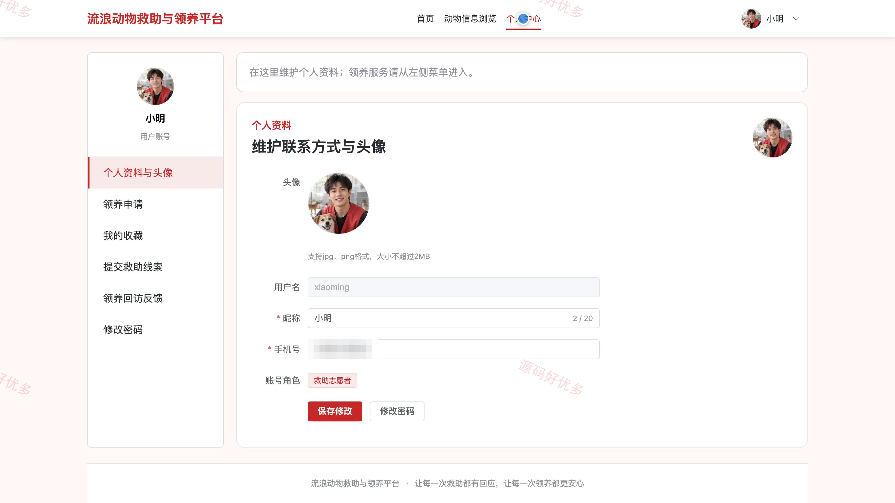
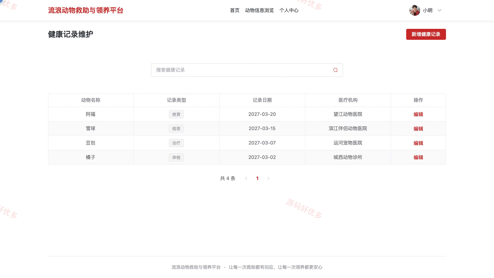
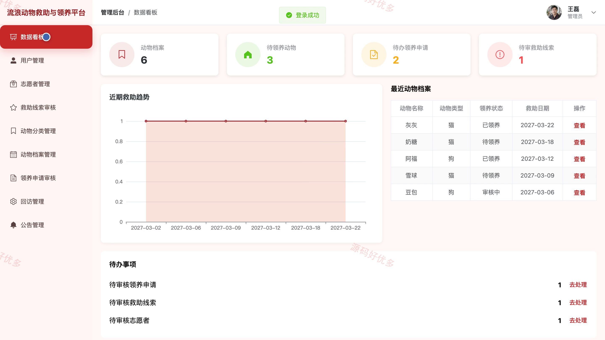
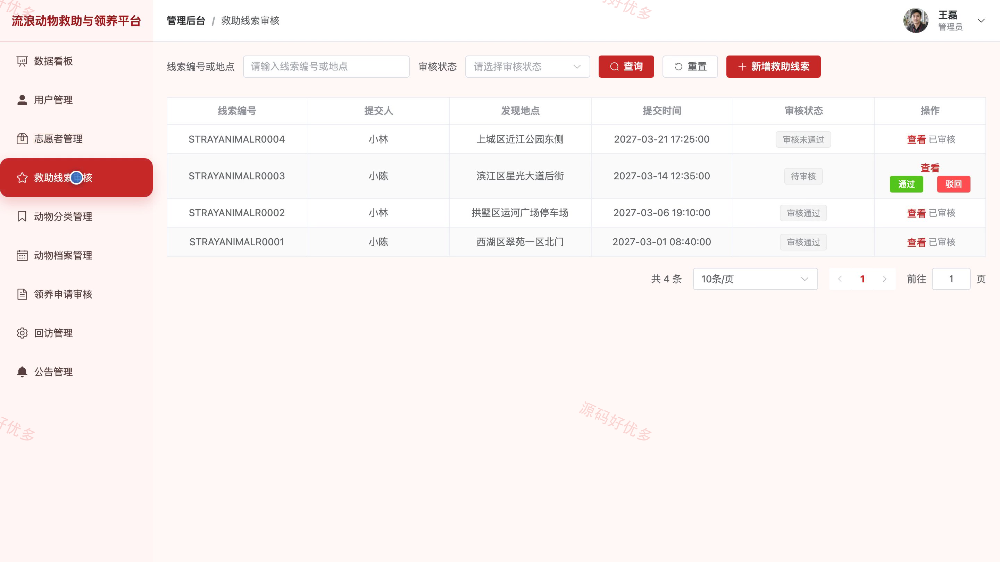
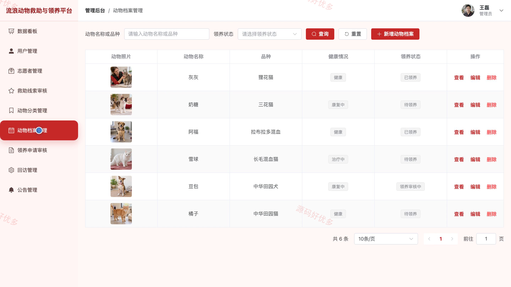

# bs132A
bs132A流浪动物救助与领养平台系统源码 Java SpringBoot3 Vue3
## 源码问题查看主页咨询

### 一、关键词
流浪动物救助、宠物领养、动物收容、志愿救助、领养回访

### 二、作品包含
源码+数据库+全套环境和工具资源+本地部署教程

### 三、项目技术
前端技术： Html、Css、Js、Vue3.4、Element-Plus
后端技术：Java、SpringBoot3.2.0、MyBatis-Plus

### 四、运行环境要求
开发工具：IDEA/eclipse + VSCODE

数据库：MySQL5.7+（共16张表）

数据库管理工具：Navicat10以上版本

环境配置软件： JDK17 + Maven3.6

前端Nodejs：16+

浏览器：谷歌浏览器

### 五、项目介绍
项目编号：bs132A

平台面向爱心用户、救助志愿者和管理员，围绕流浪动物线索提交、救助任务、动物档案、领养申请及领养回访开展协作。爱心用户可浏览和收藏待领养动物，志愿者处理救助及初审任务，管理员维护动物资料并审核线索和申请。

角色：爱心用户、救助志愿者、管理员

爱心用户功能：注册登录与个人资料管理、浏览筛选待领养动物及查看详情、收藏动物、提交救助线索、填写领养申请并查询审核进度、提交领养回访反馈。

救助志愿者功能：查看与认领救助任务、记录救助过程和处理状态、维护动物健康记录、管理寄养信息、初审领养材料、处理领养回访任务、查询个人任务。

管理员功能：管理爱心用户和志愿者、审核救助线索、管理动物分类与档案、审核领养申请、管理回访记录、发布公告、查看救助与领养数据统计。

### 六、运行截图

